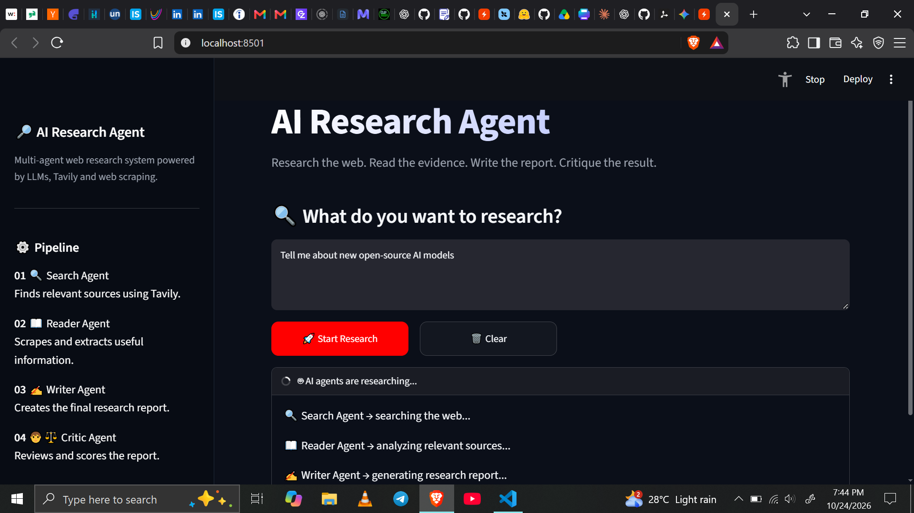
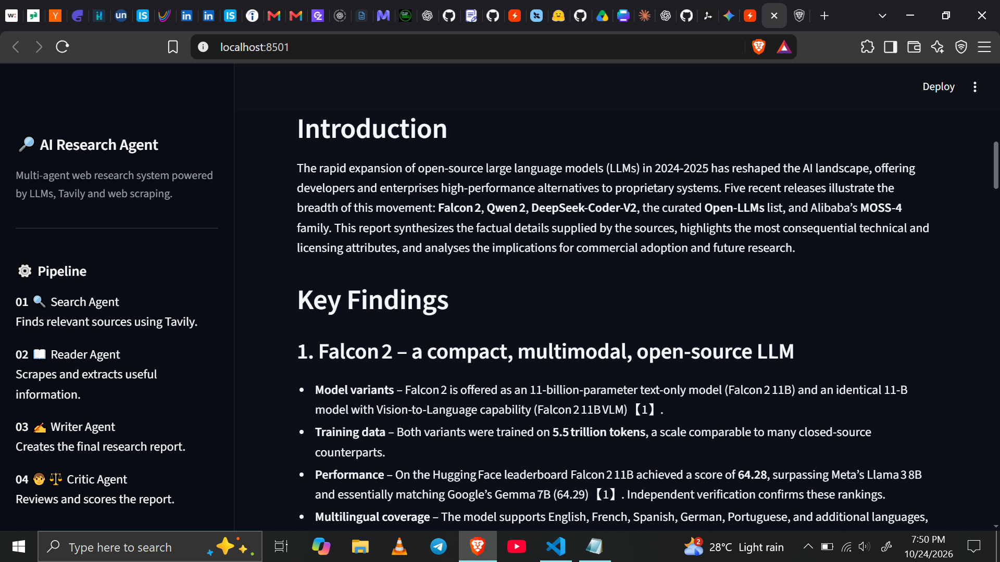
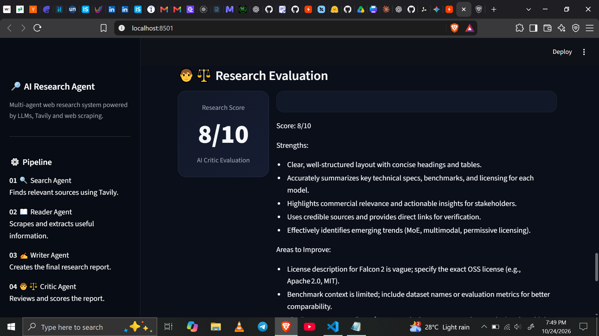

# 🔎 Multi-Agent AI Researcher

A multi-agent AI research application that searches the web, extracts information from relevant web pages, generates structured research reports, and evaluates the final output using an AI critic.

Built with Python, LangChain, Groq, Tavily, BeautifulSoup, and Streamlit, this project demonstrates how multiple specialized AI agents can work together to automate a web research workflow.

## 📸 Application Preview

<!-- Replace these placeholders with screenshots after running the application successfully. -->

### Main Dashboard


### Research Report


### Agent Trace and Critic Evaluation


> Screenshots will be added after a successful end-to-end run.

## 🚀 Key Features

- **Web Search:** Uses the Tavily Search API to discover relevant web sources.
- **Web Scraping:** Retrieves web page content using Requests and extracts readable text with BeautifulSoup.
- **Multi-Agent Workflow:** Separates searching, reading, report writing, and report evaluation into specialized stages.
- **AI Report Generation:** Uses a large language model to produce structured research reports from gathered information.
- **AI-Powered Critique:** Evaluates the generated report and provides a score, strengths, areas for improvement, and a verdict.
- **Interactive Streamlit UI:** Provides a dashboard for entering research topics and viewing reports and intermediate outputs.
- **Research Traceability:** Displays search results and scraped content so users can inspect the information used by the pipeline.

## 🏗️ System Architecture

The application follows a sequential research pipeline.

```text
                 User Research Query
                         |
                         v
              +--------------------+
              |    Search Agent    |
              |   Tavily Web Search|
              +--------------------+
                         |
                         v
              +--------------------+
              |    Reader Agent    |
              | Requests + BeautifulSoup
              +--------------------+
                         |
                         v
              +--------------------+
              |    Writer Chain    |
              | Structured Report  |
              +--------------------+
                         |
                         v
              +--------------------+
              |    Critic Chain    |
              | Score + Feedback   |
              +--------------------+
                         |
                         v
              +--------------------+
              |   Streamlit UI     |
              | Report + Evaluation |
              +--------------------+
```

### How It Works

**1. Search Agent**

Receives the research topic and uses the Tavily API to retrieve relevant web search results, including titles, URLs, and content snippets.

**2. Reader Agent**

Uses the search results to identify a relevant page and calls the scraping tool. Requests fetches the page, while BeautifulSoup removes selected non-content elements and extracts readable text.

**3. Writer Chain**

Combines the search results and extracted page content. The language model uses this research context to generate a structured report containing an introduction, key findings, conclusion, and sources.

**4. Critic Chain**

Reviews the generated report and returns a score out of 10, strengths, areas for improvement, and a short verdict.

**5. Streamlit Interface**

Provides an interactive interface for submitting research topics and reviewing the generated report, critic feedback, and intermediate research outputs.

## 🛠️ Technology Stack

| Technology | Purpose |
|---|---|
| Python | Core application logic and pipeline orchestration |
| LangChain | Agent creation, tool integration, prompt templates, and output parsing |
| Groq/Gemni | Language model inference |
| Tavily Search API | Web search and source discovery |
| Requests | Fetching web pages over HTTP |
| BeautifulSoup | HTML parsing and text extraction |
| Streamlit | Interactive web application and results dashboard |
| python-dotenv | Loading API credentials from environment variables |

## 💡 Why I Chose These Technologies

### LangChain — Agent and Workflow Orchestration

LangChain provides abstractions for connecting language models, tools, prompts, and output parsers. It allows the research workflow to be divided into specialized components rather than placing every task inside one large prompt.

### Groq — Language Model Inference

Groq provides hosted inference for supported language models. It was selected as the model provider for generating reports and evaluating their quality, allowing the application to use a hosted model instead of running a large language model locally.

### Tavily — Search for AI Research

A research agent needs external information rather than relying entirely on the model's training data. Tavily provides search results that the pipeline can pass to the reader stage, helping ground the report in retrieved web content.

### Requests and BeautifulSoup — Web Content Extraction

Search snippets often lack the depth needed for a useful report. Requests retrieves accessible web pages, and BeautifulSoup parses their HTML to extract readable text while removing selected elements such as scripts, styles, navigation, and footers.

### Streamlit — Rapid UI Development

Streamlit makes it possible to build an interactive Python-based research dashboard without creating a separate frontend application. It provides a practical way to demonstrate the pipeline, report output, and critic feedback.

### python-dotenv — API Key Management

Environment variables keep API credentials separate from application code. This reduces the risk of accidentally committing secrets to a public repository.

## 📂 Project Structure

```text
Multi_Agent_Researcher/
│
├── app.py              # Streamlit user interface
├── agents.py           # Agent definitions, prompts, writer and critic chains
├── pipeline.py         # Research pipeline orchestration
├── tools.py             # Tavily search and web scraping tools
├── requirements.txt    # Python dependencies
├── .env                # Local API credentials (not committed)
├── .gitignore          # Files excluded from Git
├── README.md           # Project documentation
└── screenshots/        # Application screenshots
```

## ⚙️ Installation and Setup

### 1. Clone the repository

```bash
git clone https://github.com/Shahidd7/Multi-Agent-Researcher
cd Multi_Agent_Researcher
```

Replace `https://github.com/Shahidd7/Multi-Agent-Researcher` with your repository URL.

### 2. Create a virtual environment

```bash
python -m venv .venv
```

Activate it on Windows PowerShell:

```powershell
.\.venv\Scripts\Activate.ps1
```

### 3. Install dependencies

```bash
python -m pip install -r requirements.txt
```

### 4. Configure environment variables

Create a `.env` file in the project root:

```env
GROQ_API_KEY=your_groq_api_key
TAVILY_API_KEY=your_tavily_api_key
```

Use valid API keys from the relevant providers. Never commit the `.env` file to GitHub.

### 5. Run the Streamlit application

```bash
python -m streamlit run app.py
```

Streamlit will provide a local URL, typically:

```text
http://localhost:8501
```

Enter a research topic and submit it to run the pipeline.

## 🧪 Example Research Queries

- Compare recent open-source large language models.
- Research retrieval-augmented generation and its practical applications.
- Investigate how AI agents are being used in software development.
- Compare different approaches to deploying LLM-powered applications.

For time-sensitive topics, the relevance and freshness of the results depend on the sources returned by the search provider.

## 🔐 Environment Variables

| Variable | Description |
|---|---|
| `GROQ_API_KEY` | API credential used for Groq model access |
| `TAVILY_API_KEY` | API credential used for Tavily search |

Keep credentials private and configure them through environment variables rather than hardcoding them in Python files.

## ⚠️ Current Limitations

- The quality of the report depends on the relevance, freshness, and reliability of retrieved sources.
- Some websites may block automated requests, require JavaScript, or return incomplete content.
- Extracted page text is limited in length by the scraping implementation.
- The critic's score is an LLM-generated assessment, not an objective measure of factual accuracy.
- API quotas, rate limits, and provider availability can interrupt research runs.
- The current pipeline is sequential. It does not independently verify every claim against multiple sources.
- The system should not be treated as a substitute for checking original sources when accuracy is critical.

## 🔮 Potential Improvements

- Add source-level citations within individual report claims.
- Add more robust URL validation and scraping error handling.
- Track token usage, request latency, and API costs.
- Add retries and clearer handling of rate-limit errors.
- Introduce automated checks for source coverage and factual consistency.
- Support report downloads and research history.
- Add tests for the search, scraping, and report-generation stages.

## 🎯 What This Project Demonstrates

This project demonstrates practical experience with:

- LLM application development
- Tool-using AI agents
- Sequential multi-agent workflows
- Prompt engineering and structured outputs
- External API integration
- Web scraping and retrieval-grounded generation
- Python application development
- Interactive AI application development with Streamlit
- AI-generated report evaluation

## 👨‍💻 Author

**Shahid**

GitHub: [Shahidd7](https://github.com/Shahidd7)

---

*Built as a hands-on project exploring practical LLM applications, web research automation, and multi-agent AI workflows.*